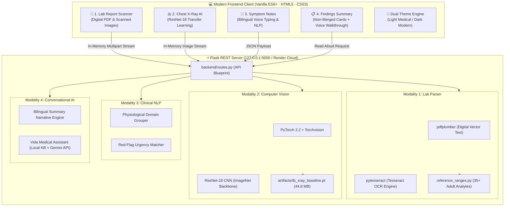

<div align="center">

# 🏥 Medical Diagnostic Assistant
### *Privacy-First Multimodal Clinical Review, ResNet-18 TB Screening & Bilingual AI Voice Assistant*

<p align="center">
  <a href="https://medical-image-diagnostic-assistant.onrender.com" target="_blank">
    
  </a>
</p>

<p align="center">
  <a href="https://medical-image-diagnostic-assistant.onrender.com" target="_blank">
    
  </a>
  
  
  
  
  
  
  
</p>

---

### 🌐 [Click Here to Launch the Live Web App](https://medical-image-diagnostic-assistant.onrender.com)
*Hosted live on Render Cloud · 100% In-Memory RAM Evaluation · Zero Cloud Data Retention*

---

</div>

> [!WARNING]
> ### ⚠️ PERSISTENT CLINICAL & REGULATORY SAFETY NOTICE
> **This software is an exploratory research and demonstration screening aid only.**
> It is **NOT** a certified medical device, has **not** been cleared or reviewed by any health regulatory agency (such as the US FDA, EMA, or CDSCO), and must **never** be used for medical diagnosis, patient triage, treatment prescription, or ruling out disease.
> - **The chest X-ray score is an experimental screening score, NOT a confirmed diagnosis.**
> - **A laboratory analyte outside standard reference intervals does NOT by itself establish an illness.**
> - **All diagnostic interpretations require evaluation by a licensed physician or certified radiologist.**

---

## 📑 Table of Contents
1. [🌟 Live Deployment & Key Highlights](#-live-deployment--key-highlights)
2. [🎨 Custom Color Palette & Design System](#-custom-color-palette--design-system)
3. [🏗️ System Architecture & Multimodal Pipeline](#️-system-architecture--multimodal-pipeline)
4. [🧭 Four-Section Clinical Workflow](#-four-section-clinical-workflow)
5. [🤖 ResNet-18 Deep Learning Screening Model](#-resnet-18-deep-learning-screening-model)
6. [📊 Held-Out Test Set Performance & Confusion Matrix](#-held-out-test-set-performance--confusion-matrix)
7. [💻 Installation & Startup Guide (Any Device / OS)](#-installation--startup-guide-any-device--os)
8. [🧪 Automated Test Suite (23 Tests)](#-automated-test-suite-23-tests)
9. [📚 Citations & Dataset Attributions](#-citations--dataset-attributions)
10. [⚖️ License & Ethical Non-Clinical Agreement](#️-license--ethical-non-clinical-agreement)

---

## 🌟 Live Deployment & Key Highlights

| Feature | Specification | Clinical / Technical Significance |
| :--- | :--- | :--- |
| **🌐 Live Cloud URL** | [medical-image-diagnostic-assistant.onrender.com](https://medical-image-diagnostic-assistant.onrender.com) | Deployed on Render with multi-worker Gunicorn WSGI server |
| **🔒 In-Memory Privacy** | `io.BytesIO` In-Memory Streams | Uploaded PDFs, photos, and notes are processed in RAM and discarded immediately — zero disk persistence |
| **🫁 CXR Screening AI** | PyTorch ResNet-18 Baseline | Pretrained ImageNet transfer learning fine-tuned on the TB Chest Radiography Database |
| **🧪 Lab Report Parser** | `pdfplumber` + `pytesseract` OCR | High-precision column alignment extracting test values, units, printed ranges, and flags (`HIGH`/`LOW`/`NORMAL`) |
| **📝 Bilingual Symptoms** | Web Speech API (STT & TTS) | Dictate or type symptoms in **English** or **Hindi (`हिंदी`)** with automatic physiological domain separation |
| **🎙️ AI Voice Walkthrough** | Web Speech Synthesis | Real-time audio assistant narrating report summaries in English and fluent Hindi with 8-bar audio visualizer |
| **🎨 Dual Theme Engine** | Light Medical & Dark Midnight | Seamless instant toggle with zero flash on page load, customized with balanced healthcare color palettes |

---

## 🎨 Custom Color Palette & Design System

The application features a human-designed, accessible healthcare design system tailored for low eye strain, high typographic legibility, and clinical clarity.

<div align="center">

### ☀️ Azure Ice & Slate — Light Medical Theme *(Default)*
| Color Swatch | Hex Code | Semantic Role |
| :---: | :---: | :--- |
|  | `#BDDDFC` | **Ice Mist Accent**: Subtle highlight rings, badge backgrounds, and secondary focus states |
|  | `#88BDF2` | **Azure Sky**: Primary buttons, interactive tabs, active navigation borders |
|  | `#6A89A7` | **Steel Slate**: Subtitle text, table headers, container outlines, and secondary icons |
|  | `#384959` | **Charcoal Slate**: High-contrast body typography, dark cards, and brand headlines |

<br />

### 🌙 Midnight Indigo & Lavender — Dark Modern Theme
| Color Swatch | Hex Code | Semantic Role |
| :---: | :---: | :--- |
|  | `#0F0E47` | **Midnight Navy**: Primary dark backdrop, top ribbon, and deep contrast framing |
|  | `#272757` | **Deep Indigo**: Card containers, interactive dropzones, modal dialogue background |
|  | `#505081` | **Muted Slate**: Inactive navigation buttons, borders, subtle divider rules |
|  | `#8686AC` | **Slate Lavender**: Secondary descriptions, metadata hints, transcript narrative text |
|  | `#34D399` | **Light Mint Green**: Positive status badges, normal range indicators, audio playback active |

</div>

---

## 🏗️ System Architecture & Multimodal Pipeline



---

## 🧭 Four-Section Clinical Workflow

### 1. 🧪 Section 1: Lab Report Scanner & OCR
- **Supported Formats**: Single PDF or image (`PNG`, `JPG`, `JPEG`) up to 20 MB.
- **Dual In-Memory Parsing**: First extracts vector text via `pdfplumber`; automatically falls back to `pytesseract` OCR for scanned physical papers.
- **Reference Range Comparison**: Flags values as `HIGH`, `LOW`, or `NORMAL` based strictly on the report's printed reference range.
- **Educational Definitions**: Explains fundamental lab terminology (*Test Value*, *Unit of Measurement*, *Reference Range*).

### 2. 🫁 Section 2: Chest X-Ray Screening Baseline
- **Supported Formats**: Standard chest radiography images (`PNG`, `JPG`, `JPEG`) up to 10 MB.
- **Screening Output**: Displays an experimental screening score ($0.0000$ to $1.0000$), decision threshold ($0.50$), predicted label, and animated risk gauge.
- **Interactive Sample Testing**: Built-in curated dataset samples (`Normal-1`, `Tuberculosis-1`) allow instant one-click testing.

### 3. 📝 Section 3: Bilingual Symptom Recording & Voice Typing
- **Bilingual Voice Input**: Dictate observations in **English (`en-US`)** or **Hindi (`hi-IN`)** via the native Web Speech API.
- **Domain Categorization**: Automatically groups symptoms into clinical domains (*Respiratory*, *Constitutional*, *Cardiovascular*, *Gastrointestinal*).
- **Red-Flag Clinical Warning**: High-visibility warning alert triggered on life-critical indicators (dyspnea, hemoptysis, severe chest pain, persistent high fever).

### 4. 📋 Section 4: Combined Findings Summary & AI Voice Assistant
- **Strict Non-Merging Guarantee**: Results from lab tests, chest X-rays, and patient symptoms are maintained on separate cards and are **never** combined into a false composite score.
- **Interactive Voice Assistant**:
  - Full spoken walkthrough of findings in **English** and **Hindi (`हिंदी`)**.
  - Audio controls: Play (`▶️`), Pause (`⏸️`), Stop (`⏹️`), and Speed pills (`0.85x`, `1.0x`, `1.2x`).
  - Pulsing 8-bar real-time audio visualizer.
  - Collapsible narrative script viewer in English prose and Devanagari Hindi.

---

## 🤖 ResNet-18 Deep Learning Screening Model

The chest radiography screening tool is built on **Transfer Learning** using a ResNet-18 convolutional neural network:

```
Input Radiograph (224×224 RGB)
         │
         ▼
ResNet-18 Feature Extractor Backbone (Pretrained on ImageNet)
  • 18 Convolutional Layers + Residual Skip Connections
  • Adaptive Average Pooling (512 feature maps)
         │
         ▼
Custom Binary Classification Head
  • Dropout (p = 0.2)
  • Linear Layer (512 inputs → 2 output logits)
         │
         ▼
Softmax Probability Score (0.0000 to 1.0000)
  • Class 0: "Normal"
  • Class 1: "TB-consistent findings"
  • Operational Screening Threshold: 0.50
```

### Training Configuration & Hyperparameters
- **Dataset**: International *TB Chest Radiography Database* (4,200 curated radiographs: 3,500 Normal, 700 Tuberculosis).
- **Split**: Stratified 70% Train (2,940), 15% Validation (630), 15% Held-Out Test (630) using `seed = 42`.
- **Loss Function**: `torch.nn.CrossEntropyLoss` with inverse class-frequency weighting ($\approx 5:1$) to mitigate class imbalance.
- **Optimizer**: `Adam` (Learning Rate = `0.0001`, Weight Decay = `1e-4`).
- **Input Dimensions**: Resized to $224 \times 224$ with ImageNet channel z-score normalization.
- **Model Checkpoint**: Saved to [`artifacts/tb_xray_baseline.pt`](artifacts/tb_xray_baseline.pt) (44.8 MB).

---

## 📊 Held-Out Test Set Performance & Confusion Matrix

Evaluation was conducted **strictly on the untouched 630 held-out test images** (525 Normal, 105 Tuberculosis) that were never seen during training or tuning:

```
                   CONFUSION MATRIX (Held-Out Test Set: N = 630)
                               Actual Normal         Actual TB
        Predicted Normal         524 (TN)              2 (FN)
        Predicted TB               1 (FP)            103 (TP)
```

| Evaluation Metric | Measured Score | Clinical Meaning |
| :--- | :---: | :--- |
| **Accuracy** | **99.52%** | Overall correct classifications ($627 / 630$) |
| **Sensitivity (Recall for TB)** | **98.10%** | Detects 103 of 105 genuine TB-consistent cases |
| **Specificity (Normal Recall)** | **99.81%** | Correctly clears 524 of 525 normal radiographs |
| **Precision (PPV)** | **99.04%** | Probability that a positive screening flag is genuine |
| **F1-Score** | **0.9856** | Harmonic balance between Precision and Sensitivity |
| **ROC-AUC** | **0.9991** | Area under the Receiver Operating Characteristic curve |

> [!NOTE]
> **Patient Grouping Limitation**: Dataset metadata lacks individual patient identifiers. Evaluation is strictly at the image level; patient-level separation cannot be claimed.

---

## 💻 Installation & Startup Guide (Any Device / OS)

You can run the application locally on **Windows**, **macOS**, or **Linux**.

### Prerequisites
- **Python 3.10+** (tested with 3.10, 3.11, 3.12, 3.13)
- Modern web browser (Chrome, Edge, Firefox, Safari)
- *(Optional)* **Tesseract OCR** for scanned PDF/image reports:
  - **Windows**: `winget install UB-Mannheim.TesseractOCR`
  - **macOS**: `brew install tesseract`
  - **Linux**: `sudo apt update && sudo apt install -y tesseract-ocr`

---

### Step-by-Step Local Setup

#### 1. Clone the Repository
```bash
git clone https://github.com/Utkarshya01/Medical-Image-Diagnostic-Assistant-.git
cd Medical-Image-Diagnostic-Assistant-
```

#### 2. Create & Activate a Virtual Environment
- **Windows (PowerShell)**:
  ```powershell
  python -m venv .venv
  .\.venv\Scripts\Activate.ps1
  ```
- **Windows (Command Prompt `cmd.exe`)**:
  ```cmd
  python -m venv .venv
  .\.venv\Scripts\activate.bat
  ```
- **macOS / Linux**:
  ```bash
  python3 -m venv .venv
  source .venv/bin/activate
  ```

#### 3. Install Dependencies
```bash
pip install --upgrade pip
pip install -r requirements.txt
```

#### 4. Launch the Server
- **Windows**:
  ```powershell
  python app.py
  ```
- **macOS / Linux**:
  ```bash
  python3 app.py
  ```

#### 5. Open in Your Browser
```
http://127.0.0.1:5000/
```
The interface loads in **Light Mode** by default.

---

## 🧪 Automated Test Suite (23 Tests)

To verify all REST endpoints, ResNet-18 model scoring, OCR parsers, and summary audio generators:

```bash
python tests/test_demo.py
```

Expected output:
```
== Healthcare Diagnostic Assistant - Baseline Test Suite ==

[PASS] GET /api/health -> 200 OK
[PASS] Disclaimer text present in /api/health
[PASS] GET /api/model/status -> 200 (model available & threshold=0.50)
[PASS] POST /api/analyse (no file) -> 400
[PASS] POST /api/analyse (.pdf) -> 415
[PASS] POST /api/xray/upload (valid PNG) -> 200
[PASS] POST /api/lab/parse (empty file) -> 400
[PASS] POST /api/lab/parse (corrupted PDF header) -> 400
[PASS] POST /api/xray/upload (corrupted image bytes) -> 400
[PASS] POST /api/xray/upload (non-CXR image rejected) -> 400
[PASS] POST /api/xray/upload (model class, score/threshold, non-diagnostic explanation verified)
[PASS] POST /api/lab/parse (in-memory parsing of reference PDF) -> 200 (rows=14)
[PASS] POST /api/lab/parse (scanned PDF via Tesseract OCR) -> 200 (ocr_used=True)
[PASS] POST /api/lab/parse (image report via Tesseract OCR) -> 200 (ocr_used=True)
[PASS] GET /api/dataset/status -> 200 (xray images=4200)
[PASS] GET / -> 200 (frontend HTML served)
[PASS] GET /api/xray/model-info -> 200 (held-out test metrics & limitations verified)
[PASS] GET /api/xray/sample-images -> 200 (curated samples available)
[PASS] GET /api/xray/image -> 200 (sample image served)
[PASS] POST /api/xray/predict (Normal-1) -> score=0.0134, label=Normal
[PASS] POST /api/xray/predict (Tuberculosis-1) -> score=1.0, label=TB-consistent findings
[PASS] POST /api/symptoms/analyze -> 200 (red_flags=['Shortness of breath (Dyspnea)', 'High fever'], domains=2)
[PASS] POST /api/summary/voice-script -> 200 (EN len=801, HI len=682)

================================================
  23 passed | 0 failed
================================================
```

---

## 📚 Citations & Dataset Attributions

1. **TB Chest Radiography Database**:
   > Rahman T, Khandakar A, Kadir MA, Islam KR, Islam KF, Mazhar R, Hamid T, Islam MT, Kashem S, Mahbub ZB, Ayari MA, Chowdhury MEH.  
   > *"Reliable Tuberculosis Detection using Chest X-ray with Deep Learning, Segmentation and Visualization."*  
   > **IEEE Access**, 2020;8:191586-191601. [doi:10.1109/ACCESS.2020.3031384](https://doi.org/10.1109/ACCESS.2020.3031384)

2. **NLM Montgomery County & Shenzhen Radiography Sets**:
   > Jaeger S, Karargyris A, Candemir S, Folio L, Siegelman J, Callaghan F, Xue Z, Dang C, Chou P, Prevedello LM, Lu PX, Antani S.  
   > *"Two public chest X-ray datasets for computer-aided screening of pulmonary diseases."*  
   > **Quantitative Imaging in Medicine and Surgery**, 2014;4(6):475-477. [doi:10.3978/j.issn.2223-4292.2014.11.20](https://doi.org/10.3978/j.issn.2223-4292.2014.11.20)

---

## ⚖️ License & Ethical Non-Clinical Agreement

This project is licensed under the **MIT License**.

```
Copyright (c) 2026 Utkarshya01

Permission is hereby granted, free of charge, to any person obtaining a copy
of this software and associated documentation files (the "Software"), to deal
in the Software without restriction, subject to the condition that this software
is NOT used as a medical diagnostic device or in clinical treatment decisions.
```

<div align="center">
  <b>Built with ❤️ for accessible, privacy-first healthcare AI research.</b>
</div>
