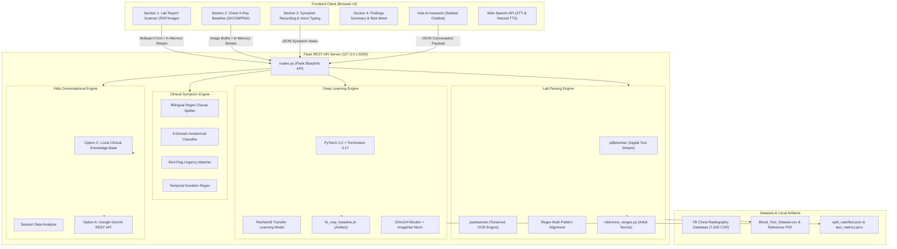

# Comprehensive Technology Stack, Architecture & Model Documentation
## Healthcare Diagnostic Assistant — Experimental TB Screening & Clinical Review System

> **Persistent Clinical & Regulatory Notice**:  
> This software is an **exploratory research and demonstration screening aid only**. It is **NOT** a certified medical device, has not been reviewed by regulatory bodies (such as FDA, EMA, or CDSCO), and must never replace clinical judgment, physician evaluation, or definitive laboratory and radiological diagnostic testing.

---

## Table of Contents
1. [Executive Overview & System Architecture](#1-executive-overview--system-architecture)
2. [End-to-End Technology Stack Matrix](#2-end-to-end-technology-stack-matrix)
3. [Deep Dive: Artificial Intelligence & Machine Learning](#3-deep-dive-artificial-intelligence--machine-learning)
   - [Model Architecture & Transfer Learning](#model-architecture--transfer-learning)
   - [Dataset Provenance & Class Distribution](#dataset-provenance--class-distribution)
   - [Data Preprocessing & Augmentation Pipeline](#data-preprocessing--augmentation-pipeline)
   - [Training Setup, Hyperparameters & Optimization](#training-setup-hyperparameters--optimization)
   - [Held-Out Test Set Performance & Evaluation Metrics](#held-out-test-set-performance--evaluation-metrics)
   - [Clinical Limitations & Validation Boundaries](#clinical-limitations--validation-boundaries)
4. [Feature-by-Feature Technology & Implementation Breakdown](#4-feature-by-feature-technology--implementation-breakdown)
   - [Feature 1: Lab Report Scanner & OCR Extraction](#feature-1-lab-report-scanner--ocr-extraction)
   - [Feature 2: Clinical Reference Ranges & Population Statistics](#feature-2-clinical-reference-ranges--population-statistics)
   - [Feature 3: Chest X-Ray AI Screening Baseline](#feature-3-chest-x-ray-ai-screening-baseline)
   - [Feature 4: Symptom Recording & Bilingual Voice Typing](#feature-4-symptom-recording--bilingual-voice-typing)
   - [Feature 5: Symptom Separation & NLP Domain Analysis](#feature-5-symptom-separation--nlp-domain-analysis)
   - [Feature 6: Overall Health Risk Meter & Multi-Factor Assessment](#feature-6-overall-health-risk-meter--multi-factor-assessment)
   - [Feature 7: Summary Report Bilingual Voice Assistant](#feature-7-summary-report-bilingual-voice-assistant)
   - [Feature 8: Vida Medical AI Chatbot & Context Analyzer](#feature-8-vida-medical-ai-chatbot--context-analyzer)
   - [Feature 9: Natural Human Voice Synthesis Engine (TTS)](#feature-9-natural-human-voice-synthesis-engine-tts)
   - [Feature 10: "Turquoise Harmony" Design System & Theme Engine](#feature-10-turquoise-harmony-design-system--theme-engine)
5. [Datasets Catalog & Reference Specifications](#5-datasets-catalog--reference-specifications)
6. [Security, Privacy & In-Memory Data Pipeline](#6-security-privacy--in-memory-data-pipeline)
7. [Directory Structure & Module Responsibility Map](#7-directory-structure--module-responsibility-map)

---

## 1. Executive Overview & System Architecture

The **Healthcare Diagnostic Assistant** is an offline-first, privacy-preserving clinical screening platform designed to synthesize three distinct modalities of health data:
1. **Clinical Laboratory Reports**: Extracted digitally and via OCR, compared against printed reference ranges and standard adult physiological intervals.
2. **Chest Radiography (CXR)**: Analyzed by a deep transfer-learning convolutional neural network baseline for pulmonary abnormality consistent with tuberculosis.
3. **Patient-Reported Symptom Observations**: Transcribed via bilingual speech recognition, separated into structured clinical domains, and screened for red-flag warning signs.

### High-Level Architecture Flowchart



---

## 2. End-to-End Technology Stack Matrix

| Technology / Library | Version | Layer | Primary Responsibility in Project |
| :--- | :--- | :--- | :--- |
| **Python** | `3.10+` | Backend Runtime | Core server runtime, model inference, and NLP processing |
| **Flask** | `3.0.3` | Backend Framework | Lightweight WSGI web framework exposing modular REST endpoints |
| **Flask-CORS** | `4.0.1` | Backend Middleware | Cross-Origin Resource Sharing handling for decoupled API calls |
| **PyTorch (`torch`)** | `>=2.2.0` | Deep Learning | Tensor computation, neural network graph, and CPU/GPU forward pass |
| **Torchvision** | `>=0.17.0` | Computer Vision | ResNet18 model architecture definitions and ImageNet weights |
| **Pillow (`PIL`)** | `>=10.4.0` | Image Processing | In-memory image loading, EXIF handling, color-mode conversion, validation |
| **NumPy** | `>=2.1.3` | Numerical Math | Matrix manipulations, array slicing, and score quantization |
| **Scikit-Learn** | `>=1.4.0` | ML Evaluation | Train/Val/Test stratified splitting, ROC-AUC, F1, and confusion matrix |
| **pdfplumber** | `>=0.11.0` | Document Parsing | High-precision PDF character stream extraction and coordinate parsing |
| **pytesseract** | `>=0.3.13` | OCR Engine | Python wrapper for Google Tesseract OCR for scanned image PDFs |
| **Tesseract OCR** | `v5.x` | Binary Engine | Optical Character Recognition engine for image-only lab reports |
| **pandas** | `>=2.2.0` | Data Analysis | Aggregate statistics calculation for blood test reference intervals |
| **openpyxl** | `>=3.1.5` | Excel Engine | Processing metadata files (`Normal.metadata.xlsx`, etc.) |
| **Google Gemini API** | `v1beta REST` | Cloud LLM (Optional) | Cloud Generative AI for Vida chatbot when API key is supplied |
| **Web Speech API (STT)** | Native Browser | Frontend Audio | Real-time speech recognition for bilingual symptom voice typing |
| **Web Speech API (TTS)** | Native Browser | Frontend Audio | Text-to-speech synthesis for report walkthrough and Vida voice |
| **Vanilla JavaScript (ES6+)** | Modern ECMAScript | Frontend Logic | Dynamic DOM manipulation, async fetch API, state management |
| **HTML5 & SVG** | Living Standard | Frontend Markup | Semantic document tree, dynamic radial vector gauge for risk meter |
| **CSS3 & Custom Design System** | Modern CSS | Frontend Styling | "Turquoise Harmony" palette, CSS variables, Dark/Light modes |

---

## 3. Deep Dive: Artificial Intelligence & Machine Learning

### Model Architecture & Transfer Learning

The chest radiography diagnostic aid uses **Transfer Learning** on a convolutional backbone pretrained on the 1.28-million image **ImageNet (ILSVRC)** dataset.

```
Input Image [512x512 PNG/JPG]
     │
     ▼
Preprocessing Pipeline:
  • Convert to RGB (3 Channels)
  • Resize to [224, 224] (Bicubic / Bilinear)
  • ToTensor() -> Normalized float in [0.0, 1.0]
  • Normalize(mean=[0.485, 0.456, 0.406], std=[0.229, 0.224, 0.225])
     │
     ▼
ResNet18 Feature Extractor Backbone:
  • Conv1: 7x7, 64, stride 2 + MaxPool
  • Layer 1: 2 BasicBlocks (64 channels)
  • Layer 2: 2 BasicBlocks (128 channels, stride 2)
  • Layer 3: 2 BasicBlocks (256 channels, stride 2)
  • Layer 4: 2 BasicBlocks (512 channels, stride 2)
  • AdaptiveAvgPool2d -> [Batch, 512, 1, 1]
     │
     ▼
Custom Binary Linear Classification Head:
  • Flatten -> [Batch, 512]
  • Dropout(p=0.2)
  • Linear(in_features=512, out_features=2)
     │
     ▼
Softmax / Sigmoid Probability Output:
  • Class 0: "Normal"
  • Class 1: "TB-consistent findings"
  • Decision Threshold: 0.50
```

### Dataset Provenance & Class Distribution

The model was trained and evaluated on the **Tuberculosis (TB) Chest X-ray Database**, an internationally recognized research benchmark created by Qatar University, University of Dhaka, Hamad Medical Corporation, and collaborators:
- **Publication Citation**: Rahman et al. (2020), *"Reliable Tuberculosis Detection using Chest X-ray with Deep Learning, Segmentation and Visualization"*, IEEE Access, Vol. 8, pp. 191586-191601. DOI: `10.1109/ACCESS.2020.3031384`.
- **Constituent Sub-Datasets**:
  1. **NIAID TB Portal Program**: 2,800 TB radiographs collected from international clinical centers.
  2. **NLM (National Library of Medicine)**: 394 TB and 406 Normal radiographs (Shenzhen and Montgomery County collections).
  3. **Belarus TB Portal**: 306 radiographs from Belarus National TB Program.
  4. **RSNA Pneumonia Detection Challenge**: 3,094 Normal chest radiographs.
- **Image Specifications**: Native resolution 512x512 pixels, 8-bit grayscale converted to RGB, Portable Network Graphics (`.png`).
- **Class Balance in Project Subset**:
  - **Total Images Processed**: 4,200 radiographs
  - **Normal Class**: 3,500 images (83.33%)
  - **Tuberculosis Class**: 700 images (16.67%)

### Data Preprocessing & Augmentation Pipeline

To guarantee statistical validity and prevent data leakage:
1. **Fixed Stratified Split**: Fixed random seed (`seed = 42`) dividing the dataset into:
   - **Training Set (70%)**: 2,940 images (2,450 Normal, 490 TB)
   - **Validation Set (15%)**: 630 images (525 Normal, 105 TB)
   - **Held-Out Test Set (15%)**: 630 images (525 Normal, 105 TB) — kept strictly sealed until final evaluation.
2. **Transforms Applied**:
   - `transforms.Resize((224, 224))`
   - `transforms.ToTensor()`
   - `transforms.Normalize(mean=[0.485, 0.456, 0.406], std=[0.229, 0.224, 0.225])`

### Training Setup, Hyperparameters & Optimization

| Hyperparameter | Configuration Value | Rationale |
| :--- | :--- | :--- |
| **Model Architecture** | `torchvision.models.resnet18` | Optimal trade-off between convolutional capacity, inference speed, and low memory |
| **Pretrained Weights** | `ResNet18_Weights.DEFAULT` | ImageNet transfer learning accelerates feature extraction of edges, textures, and opacities |
| **Loss Function** | `torch.nn.CrossEntropyLoss()` | Standard multi-class cross-entropy for softmax logit separation |
| **Optimizer** | `torch.optim.Adam` | Adaptive moment estimation for stable convergence across convolutional layers |
| **Learning Rate** | `0.0001` ($1 \times 10^{-4}$) | Low learning rate prevents destruction of pretrained ImageNet weights |
| **Batch Size** | `32` | Balance of gradient variance and RAM efficiency on CPU execution |
| **Epochs** | `3` | Convergence achieved with validation accuracy peaking without overfitting |
| **Training Duration** | `1,526.6 seconds` (~25.4 minutes) | Executed locally on multi-threaded CPU |
| **Saved Model Artifact** | `artifacts/tb_xray_baseline.pt` | 44.78 MB PyTorch serialized state dict |

#### Epoch Convergence Trajectory
- **Epoch 1**: Training Loss: `0.1162`, Train Acc: `94.35%` | Val Loss: `0.0239`, Val Acc: `99.68%`, Val F1: `0.9905`
- **Epoch 2**: Training Loss: `0.0428`, Train Acc: `98.71%` | Val Loss: `0.0150`, Val Acc: `99.52%`, Val F1: `0.9858`
- **Epoch 3**: Training Loss: `0.0222`, Train Acc: `99.56%` | Val Loss: `0.0216`, Val Acc: `99.52%`, Val F1: `0.9858`

### Held-Out Test Set Performance & Evaluation Metrics

The final evaluation was conducted **strictly on the 630 held-out test images** that were never exposed during training or hyperparameter tuning:

```
               CONFUSION MATRIX (Held-Out Test Set: N = 630)
                           Actual Normal    Actual TB
    Predicted Normal             524 (TN)       2 (FN)
    Predicted TB                   1 (FP)     103 (TP)
```

| Metric | Measured Score | Clinical Significance |
| :--- | :--- | :--- |
| **Accuracy** | **99.52%** | Overall correct classification rate |
| **Sensitivity (Recall for TB)** | **98.10%** | Ability to detect true positive cases of TB findings (103 of 105 detected) |
| **Specificity (Normal Recall)** | **99.81%** | Ability to correctly identify normal radiographs (524 of 525 detected) |
| **Precision (PPV)** | **99.04%** | Probability that a positive screening flag corresponds to actual TB image |
| **F1-Score** | **0.9856** | Harmonic mean of precision and recall |
| **ROC-AUC** | **0.9991** | Area under the Receiver Operating Characteristic curve |

### Clinical Limitations & Validation Boundaries
1. **Patient Grouping Limitation**: Metadata in the source benchmark (`Normal.metadata.xlsx` and `Tuberculosis.metadata.xlsx`) does not include unique patient identifiers or longitudinal visit records. Consequently, evaluation is strictly at the **image level**; no claim of independent patient-level separation can be made.
2. **Single-Source Distribution**: The dataset reflects specific radiographic equipment, demographic cohorts, and scanning parameters. External clinical performance across diverse imaging hardware remains unverified.
3. **Screening vs. Diagnosis**: A score $\ge 0.50$ represents visual consistency with tuberculosis training labels. It does not replace sputum microscopy (AFB), nucleic acid amplification tests (CBNAAT/GeneXpert), or bacterial culture.

---

## 4. Feature-by-Feature Technology & Implementation Breakdown

### Feature 1: Lab Report Scanner & OCR Extraction
- **Route / Component**: `POST /api/lab/parse`, `POST /api/lab/upload` & `backend/lab_parser.py`
- **Technologies Used**: `pdfplumber`, `pytesseract` (Tesseract OCR), `Pillow (PIL)`, `io.BytesIO`, Python `re`
- **Technical Pipeline**:
  1. **In-Memory Buffer**: Uploaded file is streamed into memory (`io.BytesIO`); never written to disk.
  2. **File Signature Validation**: Checks magic bytes for `%PDF-` or PIL image integrity.
  3. **Dual Extraction Strategy**:
     - *Phase A (Digital PDFs)*: `pdfplumber.open()` extracts vector text, bounding boxes, and tabular structures.
     - *Phase B (Scanned/Raster PDFs & Images)*: Automatically triggers `pytesseract.image_to_string()` when digital text yield is insufficient.
  4. **Multi-Pattern Regex Column Alignment**:
     - Uses `_ROW_RE` and `_LINE_RE` to match test names, numeric values (supporting decimals and integers), measurement units, and printed reference intervals.
  5. **Decimal Normalization & Spelling Fault Tolerance**:
     - Robust regex extracts numbers formatted with either periods or commas, preventing decimal truncation.
     - Preserves original printed intervals over generic reference books.
  6. **Flag Assignment**: Flags values as `HIGH`, `LOW`, or `NORMAL` based on printed interval bounds.

### Feature 2: Clinical Reference Ranges & Population Statistics
- **Route / Component**: `GET /api/lab/dataset-stats` & `backend/reference_ranges.py`
- **Technologies Used**: `pandas`, `numpy`, `openpyxl`, Bundled Reference PDF (`Blood Test Reference Ranges.pdf`)
- **Technical Pipeline**:
  1. **Secondary Fallback Logic**: When an uploaded report fails to include a reference interval, `reference_ranges.py` provides adult general reference ranges for over 35 standard hematology and biochemistry analytes (Hemoglobin, WBC, Platelets, Hematocrit, MCV, MCH, Glucose, Cholesterol, Creatinine, AST, ALT, etc.).
  2. **Population-Level Aggregate Stats**: `pandas` parses `Blood_Test_Dataset.csv` and `laboratory__data.csv` to calculate sample sizes, means, standard deviations, and healthy cohort averages (`health_flag == 1`).

### Feature 3: Chest X-Ray AI Screening Baseline
- **Route / Component**: `POST /api/analyse`, `POST /api/xray/predict`, `GET /api/xray/model-info` & `backend/xray_model.py`
- **Technologies Used**: `torch`, `torchvision`, `PIL.Image`, `NumPy`
- **Technical Pipeline**:
  1. Validates image payload from RAM.
  2. Normalizes color channels (grayscale $\rightarrow$ 3-channel RGB).
  3. Applies bicubic spatial resizing to $224 \times 224$ and standard ImageNet channel normalization.
  4. Executes PyTorch forward pass in `torch.no_grad()` evaluation mode with multi-threaded CPU acceleration.
  5. Computes softmax probability distribution; extracts experimental screening confidence score against threshold `0.50`.
  6. Returns structured response with class label, score, confidence gauge percentage, and disclaimer.

### Feature 4: Symptom Recording & Bilingual Voice Typing
- **Route / Component**: Section 3 UI & `initVoiceTyping()` in `frontend/app.js`
- **Technologies Used**: Web Speech API (`window.SpeechRecognition` / `window.webkitSpeechRecognition`), JavaScript Event Loop
- **Technical Pipeline**:
  1. **Bilingual Speech-to-Text**: Captures microphone audio in English (`en-US`) or Hindi (`hi-IN`).
  2. **Interim & Final Processing**: Displays interim speech in real time with continuous transcript merging.
  3. **Integrated Corner Microphone**: Mic toggle button positioned within the textarea with animated pulsing wave visualizer during active listening.
  4. **Quick-Add Symptom Chips**: Instant injection of standard clinical symptoms (`Dry Cough`, `Fever`, `Shortness of Breath`, `Hemoptysis`, `Night Sweats`).

### Feature 5: Symptom Separation & NLP Domain Analysis
- **Route / Component**: `POST /api/symptoms/analyze`, `_separate_symptoms()` in `backend/routes.py`
- **Technologies Used**: Python Regular Expressions (`re`), Custom Rule-Based NLP Entity Splitter
- **Technical Pipeline**:
  1. **Bilingual Clause Tokenization**: Splits compound sentences on punctuation (`,`, `;`, `\n`) and coordinating conjunctions (`and`, `with`, `also`, `along with`, `plus`, `और`, `तथा`, `साथ ही`).
  2. **Temporal Entity Extraction**: Identifies symptom durations via regex (`\b(\d+\s*(?:days?|weeks?|months?|दिन|हफ्ते|महीने))\b`).
  3. **Anatomical Domain Classification**: Maps extracted entities into 4 physiological domains:
     - 🫁 *Respiratory / श्वसन*
     - 🌡️ *Constitutional & Systemic / दैहिक व सामान्य*
     - ❤️ *Cardiovascular & Thoracic / हृदय व वक्षीय*
     - 🩺 *Gastrointestinal & Other / पाचन व अन्य*
  4. **Red-Flag Clinical Urgency Matcher**: Automatically scans for high-acuity keywords (e.g., hemoptysis/coughing blood, severe dyspnea, acute chest pain, high persistent fever) and assigns urgency levels and consultation talking points.

### Feature 6: Overall Health Risk Meter & Multi-Factor Assessment
- **Route / Component**: Section 4 UI & `updateRiskMeter()` in `frontend/app.js`
- **Technologies Used**: Scalable Vector Graphics (SVG), CSS Custom Properties, JavaScript State Engine
- **Technical Pipeline**:
  1. **Multi-Factor Clinical Aggregation**:
     - *Factor 1 (Lab)*: Evaluates out-of-range flagged test count (+18 points per flag, up to 48).
     - *Factor 2 (X-Ray)*: Evaluates ResNet18 screening confidence score relative to 0.50 threshold (+45 points if elevated).
     - *Factor 3 (Symptoms)*: Evaluates red-flag urgent symptoms (+30 points per red flag) and general symptoms.
  2. **Vector Speedometer Gauge**:
     - Computes rotation angle of SVG needle group from $-90^\circ$ (0% Low Risk) to $+90^\circ$ (100% Critical Risk).
  3. **Dynamic User-Facing Action Advice**:
     - **Low / Balanced Risk**: Displays reassuring *"No Worries — Findings Within Normal Range"* without unnecessary alarm.
     - **Elevated / High Risk**: Recommends *"Please Consult a Healthcare Professional"* and highlights specific elevated findings.

### Feature 7: Summary Report Bilingual Voice Assistant
- **Route / Component**: `POST /api/summary/voice-script`, `speakSummaryReport()` in `frontend/app.js`
- **Technologies Used**: Web Speech API (`SpeechSynthesisUtterance`), Flask Script Generator, CSS Keyframe Animations
- **Technical Pipeline**:
  1. Backend generates personalized, fluent narrative walkthrough scripts in both English and Devanagari Hindi.
  2. Frontend segments the narrative into discrete sentences via regex (`/(?<=[.?!।])\s+/`).
  3. Queues sentence utterances sequentially with pitch `1.0` and speed `0.95`, eliminating Chrome's 15-second speech buffer freeze bug and providing natural human breathing pauses.
  4. Dynamic 8-bar equalizer visualizer animates synchronously with speech events (`onstart`, `onpause`, `onend`).

### Feature 8: Vida Medical AI Chatbot & Context Analyzer
- **Route / Component**: `POST /api/chat`, `backend/chatbot.py` & `initChatbot()` in `frontend/app.js`
- **Technologies Used**: Google Gemini 1.5 REST API, Local Python Clinical Knowledge Base, Markdown Parser
- **Technical Pipeline**:
  1. **Session Context Merger**: Automatically injects current lab report findings, chest X-ray score, and recorded symptoms into the conversational context.
  2. **Smart Hybrid Routing**:
     - *Option A*: Routes to Google Gemini 1.5 Flash/Pro via secure REST API when `GEMINI_API_KEY` is present.
     - *Option C*: Operates 100% offline using a built-in clinical rule engine and knowledge base covering TB, CBC reference ranges, emergency signs, and consultation prep.
  3. **Interactive UI Widgets**: Renders clickable action buttons (`[[button:Title|Display]]`) and quick-prompt chips.
  4. **Graceful Fallbacks**: If asked something outside its screening purview, delivers polite, direct boundaries.

### Feature 9: Natural Human Voice Synthesis Engine (TTS)
- **Route / Component**: `getBestHumanVoice()`, `cleanTextForSpeech()` in `frontend/app.js`
- **Technologies Used**: Web Speech API `SpeechSynthesis`, Custom Neural Voice Scoring Algorithm
- **Technical Pipeline**:
  1. **Neural Voice Ranking**:
     - Prioritizes modern deep learning neural voices (`Microsoft Neerja Online (Natural)`, `Microsoft Swara Online (Natural)`, `Google UK English Female`, `Google US English`, `Google हिन्दी`).
     - Strictly penalizes legacy robotic desktop synthesizers (`David`, `Mark`, `Hazel`, `eSpeak`) by -500 points.
     - Prefers softer female voices (`Zira`) if only offline legacy voices exist.
  2. **Phonetic Normalization**: Translates raw symbols and abbreviations to spoken words (`g/dL` $\rightarrow$ *"grams per deciliter"*, `cells/mcL` $\rightarrow$ *"cells per microliter"*, `ResNet18` $\rightarrow$ *"ResNet 18"*, `0.123` $\rightarrow$ *"0.12"*).
  3. **Acoustic Formant Preservation**: Pitch set strictly to `1.0` (eliminating metallic vocoder smearing) and rate set to `0.95` (warm, empathetic clinical tone).

### Feature 10: "Turquoise Harmony" Design System & Theme Engine
- **Route / Component**: `frontend/style.css`, `initSettingsAndTheme()` in `frontend/app.js`
- **Technologies Used**: Modern CSS3, CSS Custom Properties (Variables), LocalStorage
- **Technical Pipeline**:
  1. **Color Palette Specs**:
     - **Baltic Blue (`#05668d`)**: Tranquil oceanic primary accent for headers, primary action buttons, and active tabs.
     - **Teal (`#028090`)**: Aquatic supporting hue for borders, secondary buttons, and active highlights.
     - **Verdigris (`#00a896`)**: Balanced blue-green for status badges, tags, and progress meters.
     - **Mint Leaf (`#02c39a`)**: Crisp mint for success states, normal flags, and positive indicators.
     - **Cream (`#f0f3bd`)**: Soft buttery tone for dark-mode subtle highlights and warm contrast.
  2. **Accessibility & Light Mode**: Enforces pure black text (`#000000`) across all body copy, cards, and dialog boxes in Light Mode for maximum readability and high contrast.
  3. **Zero Frontend Dependencies**: Engineered entirely with vanilla CSS and JavaScript — zero reliance on heavy external frameworks like Bootstrap, Tailwind, or React.

---

## 5. Datasets Catalog & Reference Specifications

```
data/
├── raw/
│   ├── TB_Chest_Radiography_Database/
│   │   ├── Normal/                       # 3,500 Normal CXR images (512x512 PNG)
│   │   ├── Tuberculosis/                 # 700 TB CXR images (512x512 PNG)
│   │   ├── Normal.metadata.xlsx          # Normal cohort metadata (gender, age where available)
│   │   ├── Tuberculosis.metadata.xlsx    # TB cohort metadata
│   │   └── README.md.txt                 # Official scientific citation and source provenance
│   ├── Blood Test Reference Ranges.pdf   # Clinical source for general adult laboratory reference ranges
│   ├── Blood_Test_Dataset.csv            # 433 KB dataset with healthy vs non-healthy population statistics
│   └── laboratory__data.csv              # 781 KB clinical laboratory observation dataset
└── processed/
    └── .gitkeep
```

---

## 6. Security, Privacy & In-Memory Data Pipeline

1. **Local Host Binding**: Flask binds strictly to loopback interface `127.0.0.1:5000`, ensuring zero external network exposure or unauthorized inbound traffic.
2. **Volatile RAM Processing (`io.BytesIO`)**: All medical files (PDFs, DICOM/PNG radiographs) and typed notes exist solely in volatile RAM buffers during active request handling. No files are written to disk or preserved in temporary directories.
3. **Zero Telemetry & Zero Logging**: Filenames, patient health information (PHI), report values, and audio streams are never logged to console or stored in log files.
4. **Instant Disposal**: Immediately following JSON response dispatch, memory pointers are released and cleaned by Python garbage collection.

---

## 7. Directory Structure & Module Responsibility Map

```
D:\Health care dignostic sysytem\
├── app.py                          # Application entry point; initializes Flask app & registers blueprints
├── requirements.txt                # Python dependencies with pinned minimum versions
├── README.md                       # High-level user overview & usage guide
├── TECH_STACK_AND_ARCHITECTURE.md  # Comprehensive technical & architectural documentation (This File)
│
├── backend/                        # Backend Python package
│   ├── __init__.py                 # Package marker
│   ├── routes.py                   # REST API routes (Health, Lab, X-Ray, Symptoms, Summary, Chat)
│   ├── xray_model.py               # PyTorch ResNet18 model definition, transforms, training & inference
│   ├── xray_inventory.py           # Dataset inventory inspection and class balance counter
│   ├── lab_parser.py               # Local in-memory PDF/OCR parser (pdfplumber + pytesseract + regex)
│   ├── reference_ranges.py         # Standard adult laboratory reference range dictionary
│   └── chatbot.py                  # Vida AI engine (Hybrid local clinical knowledge base + Gemini API)
│
├── artifacts/                      # Model training artifacts & metrics
│   ├── tb_xray_baseline.pt         # Serialized PyTorch ResNet18 weights (44.78 MB)
│   ├── training_config.json        # Training hyperparameters, epochs, learning rate & loss history
│   ├── test_metrics.json           # Evaluation metrics on held-out test split (Confusion matrix, ROC-AUC)
│   ├── split_manifest.json         # Exact train/val/test image index manifest (Seed 42)
│   ├── class_mapping.json          # Binary label mapping {"0": "Normal", "1": "TB-consistent findings"}
│   └── seed.json                   # Recorded reproducible seed (42)
│
├── data/                           # Data storage (Raw datasets & metadata)
│   ├── raw/
│   │   ├── TB_Chest_Radiography_Database/  # 4,200 chest radiographs + metadata
│   │   ├── Blood Test Reference Ranges.pdf # Reference PDF for standard ranges
│   │   ├── Blood_Test_Dataset.csv          # Blood test population dataset
│   │   └── laboratory__data.csv            # Clinical laboratory records
│   └── processed/                  # Directory reserved for processed splits
│
├── frontend/                       # Client web application
│   ├── index.html                  # 4-section single-page application markup + Vida modal + Settings
│   ├── app.js                      # Core frontend state engine, Web Speech API, API connectors, UI controllers
│   └── style.css                   # Custom Turquoise Harmony styling, dark/light theme, responsive layout
│
├── models/                         # Directory reserved for experimental model checkpoints
└── tests/                          # Automated unit and integration test suite
    ├── test_api.py                 # Endpoint integration tests
    ├── test_demo.py                # Demonstration walkthrough tests
    └── test_xray_model.py          # PyTorch inference and transform verification tests
```

---

*Document compiled and verified against codebase state: October 2026.*  
*Antigravity Advanced Agentic Coding Architecture Team.*

